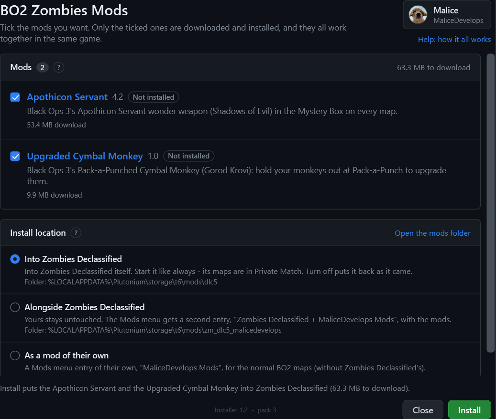
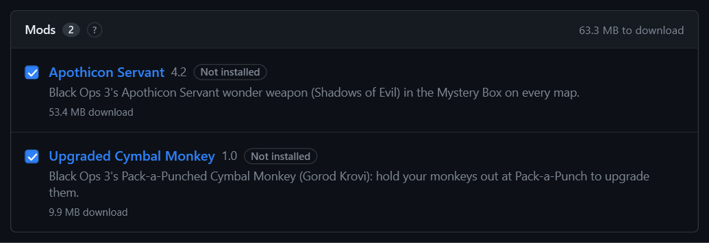
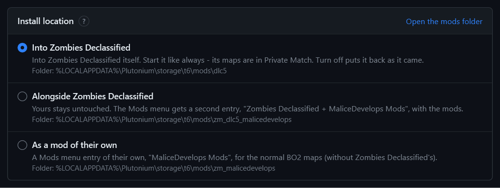
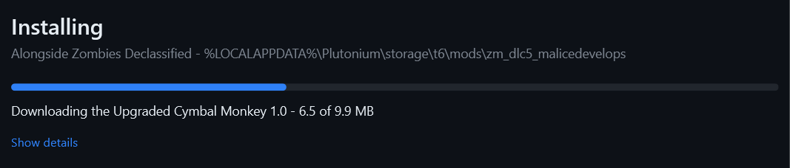
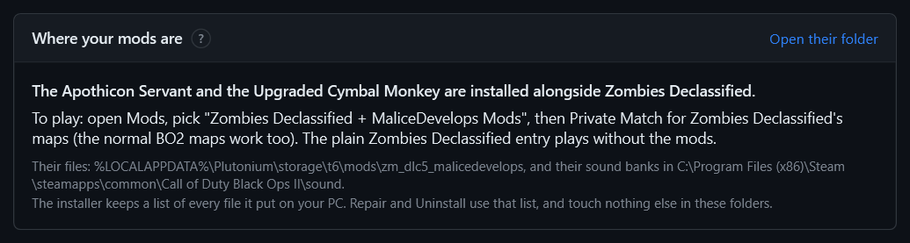
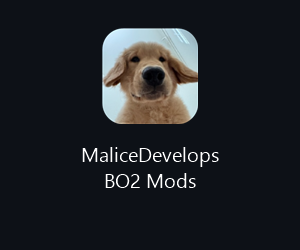
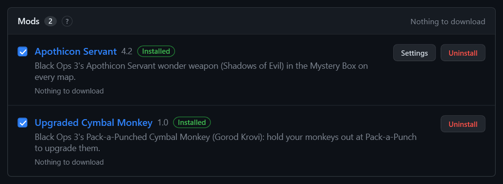
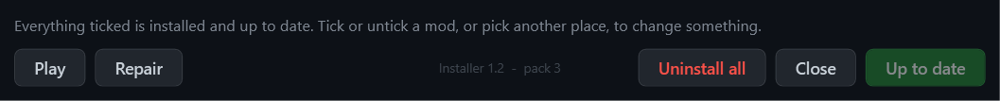
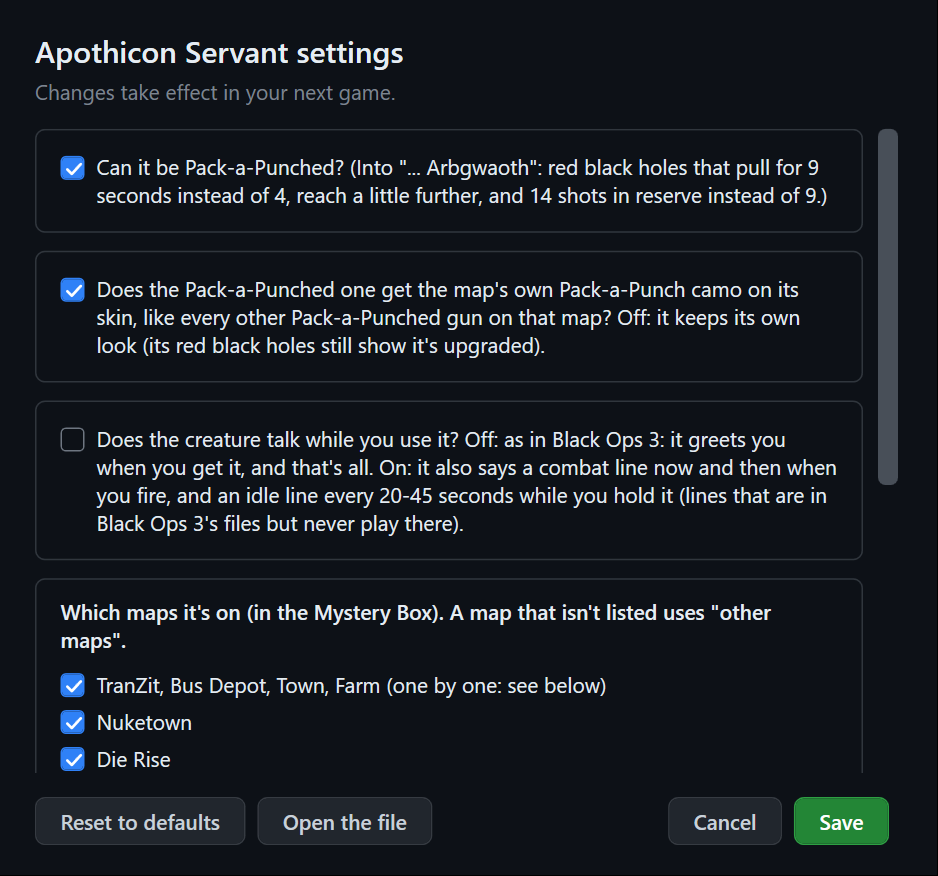

# MaliceDevelops BO2 Mods - installer

One installer for all of my Black Ops 2 Zombies (Plutonium) mods. Tick the ones you want: only those are downloaded and installed, and they all work together in the same game, with or without Zombies Declassified.

### [⬇ Download the installer](https://github.com/MaliceDevelops/bo2-mods-installer/releases/latest)

Under **Assets**, download `MaliceDevelops_BO2_Mods_Installer_v<version>.zip`. **This is the download for combining my mods.** Each mod's own page also has a download with just that mod.

## The mods

| Mod | What it is |
| --- | --- |
| [Apothicon Servant](https://github.com/MaliceDevelops/apothicon-servant-bo2) | Black Ops 3's Shadows of Evil wonder weapon: black holes that drag zombies in and crush them. In the Mystery Box. |
| [Upgraded Cymbal Monkey](https://github.com/MaliceDevelops/upgraded-cymbal-monkey-bo2) | Black Ops 3's Pack-a-Punched Cymbal Monkey: hold your monkeys out at Pack-a-Punch for BO3's bass pulse, dubstep song and bigger explosion. |

## Before you start

- Black Ops 2 with [Plutonium](https://plutonium.pw), and you've played Zombies at least once.
- Windows 10 or 11 and an internet connection. (Anywhere else: follow `README.txt` in the download to install by hand.)
- Optional: **Zombies Declassified**, to play the mods on its Black Ops 1 maps too.

## Install, step by step

### 1. Close Black Ops 2

Files can't be changed while the game is open. If it is, the installer says so and waits for you to press **Try again**.

### 2. Unzip the download and double-click `Install.bat`

Unzip it anywhere (your Downloads folder is fine). Windows may warn about running a downloaded `.bat`: Install.bat only downloads my mods from github.com/MaliceDevelops, checks every file's SHA-256, and copies them into place. You can read `installer\install.ps1` to see exactly what it does.

A console flashes up for a second and the installer's window opens. Everything happens in that window from here on.

### 3. Tick the mods you want

- Each mod shows its version and whether it's **Not installed**, **Installed**, or has an **Update** waiting.
- The mod's name links to its own page.
- Below each one is its download size; the top right shows the total for what you ticked.
- Only the ticked mods are downloaded, each from its own GitHub page.

Not sure what something is? **Hover over it** for a short explanation, or press a **?** (or **Help: how it all works**, top right) for a guide with pictures.

### 4. Choose where they go

| Choice | What it does | How you play |
| --- | --- | --- |
| **Into Zombies Declassified** | Adds the mods to your Zombies Declassified itself (`mods\dlc5`). | Start Zombies Declassified like always. Its maps are under **Private Match**; the normal BO2 maps work too. **Turn off** gives you plain Zombies Declassified back any time. |
| **Alongside Zombies Declassified** | Your Zombies Declassified stays exactly as it is. The Mods menu gets a second entry with the mods (`mods\zm_dlc5_malicedevelops`). | Open **Mods**, pick **Zombies Declassified + MaliceDevelops Mods**, then **Private Match** for its maps. Pick the plain **Zombies Declassified** entry to play without the mods. |
| **As a mod of their own** | The mods in their own Mods menu entry (`mods\zm_malicedevelops`), without Zombies Declassified. The only choice if you don't have it. | Open **Mods**, pick **MaliceDevelops Mods**, then play any normal BO2 map. |

Each choice shows the exact folder it uses. Your mods are only ever in one place: picking another one and pressing **Move** moves them there (nothing is downloaded again) - the window says so before you press it. **Open the mods folder** opens Plutonium's mods folder (`%LOCALAPPDATA%\Plutonium\storage\t6\mods`).

### 5. Press Install

The line above the buttons says exactly what will happen ("Install puts the Apothicon Servant and the Upgraded Cymbal Monkey into Zombies Declassified (63.3 MB to download)."). Press the green button and the window shows the progress: each download, then each file put in place. **Show details** lists every file and where it goes.

When it's done, the window comes back with your mods marked **Installed** and **Installed.** at the top.

### 6. Play

Press **Play** to open Plutonium's launcher (pick Black Ops II Zombies there), and play as shown under **Where your mods are**. If you put the mods into or alongside Zombies Declassified, remember that **its own maps are only listed in Private Match**: Solo shows the normal BO2 maps.

## Where your mods are

Once something is installed, the top of the window says which mods are installed, where, and how to start them - plus their exact folder (**Open their folder** opens it) and where their sound banks went.

The installer writes down every file it puts on your PC (in `%LOCALAPPDATA%\Plutonium\storage\t6\malicedevelops_mods.json`). **Repair**, **Move** and **Uninstall** work from that list: they never search your folders, and nothing else in them is touched. The sound banks are the one part outside Plutonium's folder - Black Ops 2 only reads sound banks from its own `sound` folder.

## The shortcut

The installer stays on your PC: a **MaliceDevelops BO2 Mods** shortcut on your desktop and in the Start menu opens it again, so you don't need to keep the zip. Use it to add, remove, update, repair or set up the mods. When a newer installer is out, it updates itself first.

## Managing your mods

Open the shortcut. Your installed mods are ticked and marked **Installed**:

The green button always says what it will do, and the line above it spells it out:

| The button says | When |
| --- | --- |
| **Install** | You ticked a mod that isn't installed yet. |
| **Update** | A ticked mod shows **Update from ...**: a newer version is out. Only what changed is downloaded; your settings are kept. |
| **Remove** | You unticked an installed mod (its own **Uninstall** button does the same). |
| **Move** | You picked another install location. |
| **Apply changes** | More than one of these at once. |
| **Up to date** | Nothing to do. |

The installer stays open after everything you do in it; only **Close**, the **X** and **Play** close it.

The buttons at the bottom:

| Button | What it does |
| --- | --- |
| **Play** | Opens Plutonium's launcher. |
| **Repair** | Checks every installed file against the published version and downloads again only what's missing or damaged. Your settings are kept. Use it if a mod acts broken (black textures, no sound, it doesn't show up), or after a Zombies Declassified update or reinstall. |
| **Turn off** / **Turn on** | Only for mods installed into Zombies Declassified. **Turn off** sets them aside so Zombies Declassified plays exactly as it came; **Turn on** puts them back. Nothing is deleted or downloaded. |
| **Uninstall all** | Removes all of my mods and puts back anything it set aside. Asks first. The installer and its shortcut stay. |
| **Close** | Closes the installer. |

## Settings

A mod with settings gets a **Settings** button once it's installed:

Tick or untick what you want and press **Save**; it takes effect in your next game. **Reset to defaults** puts back the mod's own settings. **Open the file** opens the settings file in Notepad. Your settings are kept when you update.

## Help

**Help: how it all works** (top right) and each **?** open a guide inside the installer: every part of the window explained, with pictures - picking mods, where they go, playing, updates, Repair, Turn off / on, Settings, Uninstall, the shortcut, and what to do if something goes wrong. Hovering over anything gives a short explanation too.

## Each mod's own download

Each mod's GitHub page also has a download with **just that mod**. Its window shows only that mod, with a link back here:

It installs, updates or removes only that mod, and leaves any other mod of mine alone. Its install locations are the same three. To combine mods, use this installer.

## Uninstall

Press **Uninstall all** in the window, or double-click **Uninstall.bat** (it opens the same window). Either way it first says exactly what goes and from where, and asks. It removes only what the installer put on your PC, and puts back anything it set aside. Your Zombies Declassified is left as it came. The installer and its **MaliceDevelops BO2 Mods** shortcut stay, so you can install again; to remove them too, delete the shortcut and the folder `%LOCALAPPDATA%\MaliceDevelops`.

## How it stays lean

- **One small shared file.** BO2 only loads a mod's fastfiles from a couple of fixed slots, so all of my mods share one small file (a few MB: weapon stats, models, animations, effects). With Zombies Declassified, that leaves its second free slot for someone else's mod.
- **Everything heavy is per mod.** Each mod's textures, scripts and sounds are separate files, and only the ticked mods' files are downloaded and installed. The game streams the textures in when they're on screen.
- **Each mod comes from its own GitHub page,** and every file is checked (SHA-256) before anything is installed. Nothing changes until all downloads are done.
- **Alongside Zombies Declassified** copies Zombies Declassified's own small files (about 16 MB) into the second entry; its maps and sounds are shared, not copied. The installer brings that copy up to date every time it runs.

## Good to know

- **Co-op:** everyone in the game needs the same mods installed.
- **Other mods:** script mods like B2OP work fine alongside.
- **After a Zombies Declassified update or install:** open the shortcut and press **Repair**. **Zombies Declassified + MaliceDevelops Mods** gets the update then too.
- **Install by hand:** `README.txt` in the download has the steps.
- **Bugs:** open an issue on that mod's page. The installer's **Show details** lists every step it took - include it.

## Credits

The mods are made by **MaliceDevelops** - see each mod's page for its own credits. Built with [OpenAssetTools](https://github.com/Laupetin/OpenAssetTools) and [Plutonium](https://plutonium.pw).

Free fan mods, not affiliated with or endorsed by Activision. Don't sell them.
